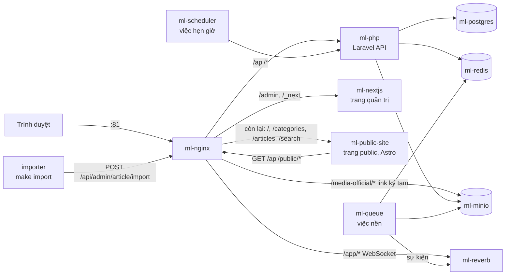

# Kiến trúc hiện tại

Cập nhật: 2026-10-25. Hệ thống đang chạy thế nào trên môi trường dev. Sửa file này cùng commit với thay đổi về container, đăng nhập, phân quyền hoặc cấu trúc dữ liệu. Chi tiết từng tính năng nằm trong [docs/features/](../features/). Kiến trúc của bản `v1.0.0` (trước khi thu gọn): [as-is.md](../archive/engineering-lab/architecture/as-is.md).

## 1. Container (dev, Docker Compose)



| Container | Vai trò |
|---|---|
| `ml-nginx` | Cửa vào duy nhất (máy :81 → 8080 bên trong). Cấu hình: `docker/nginx/default.conf` |
| `ml-php` | REST API (php-fpm). Khởi động lần đầu thì migrate và seed DB trống. Có `ffmpeg` để đọc thời lượng và tạo ảnh nhỏ |
| `ml-queue`, `ml-scheduler`, `ml-reverb` | Cùng image với `ml-php`: làm việc nền (hàng đợi Redis), chạy lệnh hẹn giờ, gửi thông báo tức thì qua WebSocket. Đổi code việc nền thì `make workers-restart` |
| `ml-nextjs` | Trang quản trị, chỉ dưới `/admin` (đăng nhập `/admin/login`, [ADR-0021](../adr/0021-public-home-categories-articles.md)) |
| `ml-public-site` | Trang public ở gốc `/`, đọc như trang tài liệu: trang chủ kiểu diễn đàn (nhóm → danh mục), `/categories/…`, `/articles/…`, `/search`, tài khoản người dùng (Astro, HTML render ở server; chỉ một script nhỏ cho tài khoản người dùng, ~3 KB; gọi API qua nginx, giữ kết quả 60 giây). `/docs…` cũ được nginx chuyển hướng tới `/`; `/skills…`, `/guides…` cũ được Astro chuyển hướng ([ADR-0019](../adr/0019-public-user-frontend.md), [ADR-0021](../adr/0021-public-home-categories-articles.md), [ADR-0022](../adr/0022-trang-tai-lieu-kinh-nghiem.md)) |
| `ml-postgres` | Dữ liệu và tìm kiếm. DB `testing` riêng cho test |
| `ml-redis` | Phiên đăng nhập, cache, hàng đợi (test dùng DB 14 / 15) |
| `ml-minio` (+ `ml-minio-init`) | Kho file. Bucket không cho đọc công khai; trình duyệt upload và tải bằng link ký tạm. Bucket chính bật lưu phiên bản, bản cũ tự hết hạn sau 30 ngày (thùng rác) |

## 2. Các nhóm API

76 API (đếm 2026-10-25). Hợp đồng đầy đủ: `laravel-api/openapi.json` (sinh từ code, [ADR-0008](../adr/0008-code-first-openapi-contract.md)). Mọi response cùng một dạng: `{ "data": …, "error": { "status", "code", "messages" } }`.

| Nhóm | Đường dẫn | Tài liệu |
|---|---|---|
| Đăng nhập, thiết bị | `sanctum/csrf-cookie`, `admin/credential/*`, `admin/admin-session/*` | [dang-nhap.md](../features/dang-nhap.md) |
| Quản trị viên, vai trò, quyền, phòng ban | `admin/admin-mst/*`, `admin/role/*`, `admin/permission/*`, `admin/department/*` | [quan-tri-vien.md](../features/quan-tri-vien.md), [phan-quyen-dong.md](../features/phan-quyen-dong.md), [phong-ban.md](../features/phong-ban.md) |
| Trang tổng quan | `admin/dashboard/summary` | [bai-viet.md](../features/bai-viet.md) |
| Files | `admin/media/*` (18 API: thư mục, upload, upload chia phần, tải, thùng rác, khóa thư mục) | [quan-ly-file.md](../features/quan-ly-file.md) |
| Tìm kiếm, nhật ký | `admin/search`, `admin/audit-log/*` | [tim-kiem.md](../features/tim-kiem.md), [nhat-ky-thay-doi.md](../features/nhat-ky-thay-doi.md) |
| Việc nền | `admin/background-task/*`, `broadcasting/auth` | [viec-nen-va-thong-bao.md](../features/viec-nen-va-thong-bao.md) |
| Nhập Obsidian | `admin/article/import` (token API hoặc phiên của chủ) | [nhap-tu-obsidian.md](../features/nhap-tu-obsidian.md) |
| Người dùng cuối | `user/*` (bộ đăng nhập `user`), `admin/end-user/*` | [nguoi-dung-cuoi.md](../features/nguoi-dung-cuoi.md) |
| Danh mục, bài viết | `admin/content-category/*`, `admin/article/*` | [bai-viet.md](../features/bai-viet.md) |
| Public | `public/home`, `public/categories/*`, `public/articles/*` (cả lượt xem), `public/search`, `public/files/*` | [trang-public.md](../features/trang-public.md), [bai-viet.md](../features/bai-viet.md) |

## 3. Đăng nhập và phân quyền

```mermaid
sequenceDiagram
    participant B as Trình duyệt
    participant A as Laravel API
    B->>A: GET /api/sanctum/csrf-cookie
    A-->>B: cookie XSRF-TOKEN
    B->>A: POST /api/admin/credential/login (+ ghi nhớ?)
    A->>A: giới hạn sai theo tên + IP và theo IP, kiểm mật khẩu, tạo phiên mới
    A-->>B: cookie phiên (phiên trong Redis, thiết bị trong bảng admin_session)
    B->>A: gọi /api/admin/* kèm cookie
    A->>A: auth:sanctum → quyền = tên route (vd. article.list); vai trò Chủ luôn qua
```

| Phần | Cách làm | Quyết định |
|---|---|---|
| Phiên | Cookie phiên Sanctum, không có token trong trình duyệt. Ghi nhớ đăng nhập 30 ngày, riêng từng thiết bị | [ADR-0004](../adr/0004-sanctum-spa-cookie-auth.md) |
| Quyền | Mỗi API quản trị là một quyền, gom vào vai trò lưu trong DB (`spatie/laravel-permission`). Có sẵn vai trò Chủ (toàn quyền) và Chỉ xem | [ADR-0013](../adr/0013-dynamic-permissions.md) |
| Khóa thư mục | Thư mục Files gắn phòng ban thì chỉ thành viên (và Chủ) thấy. Mọi API Files đi qua `App\Services\Media\FolderAccess` | [ADR-0017](../adr/0017-departments-folder-policies.md) |
| Người dùng cuối | Bộ đăng nhập riêng `user` trên bảng `end_user`, chung cookie phiên với admin nhưng không gọi được API quản trị (và ngược lại) | [ADR-0020](../adr/0020-end-user-accounts.md) |
| Token API | Token cá nhân Sanctum chỉ mở được API nhập Obsidian | [ADR-0010](../adr/0010-python-importer-tooling.md) |
| Nhật ký | Một bảng `audit_log`: mọi thêm / sửa / xóa, đăng nhập, đăng xuất, đăng nhập sai | [ADR-0006](../adr/0006-audit-log.md) |

## 4. Dữ liệu

| Bảng | Dùng cho |
|---|---|
| `content_category`, `category_attachment` | Nhóm và danh mục (2 cấp), đính kèm link / file của danh mục |
| `article`, `article_category`, `article_media` | Bài viết (bài cha tối đa 10 cấp, lượt xem), bài thuộc nhiều danh mục, file nhúng trong bài (mã public riêng) |
| `media_mgmt` | File và thư mục trong Files (đường dẫn ảo, khóa MinIO, kích thước, thời lượng, trạng thái upload, đã xóa hay chưa) |
| `department`, `admin_department`, `department_policy` | Phòng ban, thành viên, thư mục khóa theo phòng ban |
| `admin_mst`, `admin_session` | Quản trị viên, thiết bị đang đăng nhập |
| `end_user`, `end_user_saved`, `app_setting` | Người dùng cuối, yêu thích / xem sau, công tắc đăng ký |
| `roles`, `permissions`, `model_has_roles`, `model_has_permissions`, `role_has_permissions` | Phân quyền động |
| `audit_log` | Nhật ký thay đổi |
| `personal_access_tokens` | Token của công cụ nhập Obsidian |
| `failed_jobs`, `sessions`, `cache`, `cache_locks` | Bảng của Laravel (phiên thật nằm trong Redis) |

Tìm kiếm ([ADR-0009](../adr/0009-postgres-search.md)): cột `search_tsv` + chỉ mục GIN cho tìm theo từ (có `unaccent`, gõ không dấu vẫn ra), chỉ mục trigram cho gõ sai; tên file dùng chỉ mục trigram `media_mgmt_name_trgm`. Không dùng search engine riêng.

## 5. Môi trường và đưa code lên

| Bước | Cách làm |
|---|---|
| Dev | Docker Compose (`make up`), mã nguồn gắn thẳng vào container ([docker/README.md](../../docker/README.md)) |
| Kiểm tra | `make verify` (trong container dev, gồm cả code chưa commit), `make e2e`; `make ci` chạy giống hệt GitHub / GitLab trên code đã commit ([ADR-0016](../adr/0016-ci-shared-folder.md)) |
| Bản demo prod-like | `make cd` dựng bằng Terraform trên http://localhost:9443 ([ADR-0011](../adr/0011-infrastructure-as-code.md)). Đang tạm dừng, môi trường đã xóa |
| Sao lưu | `make backup`: `pg_dump` + bản sao MinIO + `docker/.env` → rclone ([runbook](../runbooks/backup-restore.md)) |
| Dọn dẹp | `make clean` sau mỗi việc ([hướng dẫn dọn dẹp](../runbooks/don-dep.md)) |

## 6. Số liệu (2026-10-19)

| | |
|---|---|
| Backend | ~12 nghìn dòng PHP trong `app/`, 90 migration, 299 test PHPUnit |
| Trang quản trị | ~16,8 nghìn dòng TS/TSX (không tính kiểu sinh tự động), 158 test Vitest |
| Trang public | ~0,3 nghìn dòng TS/Astro; RAM production 35 MB, image 248 MB, 0 KB JavaScript xuống trình duyệt |
| Công cụ nhập Obsidian | 63 test pytest |
| Test trình duyệt | 10 luồng Playwright |
